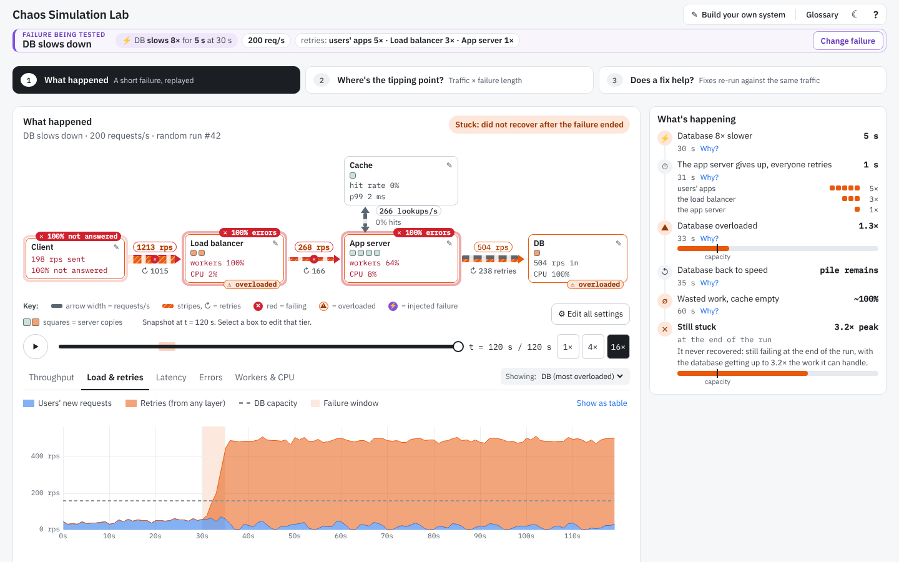
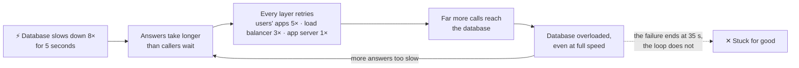
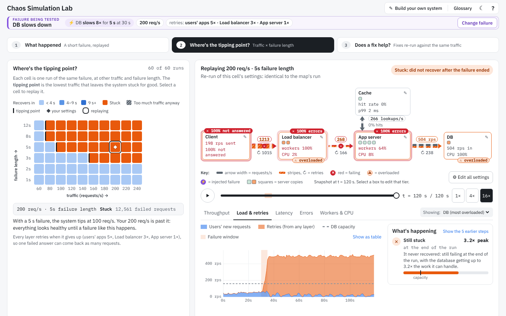
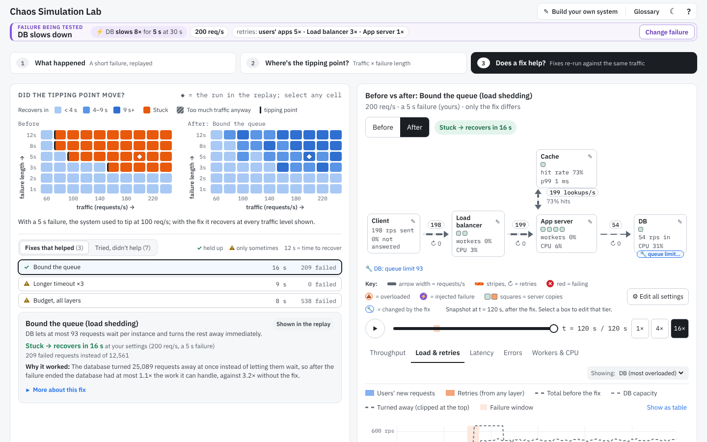
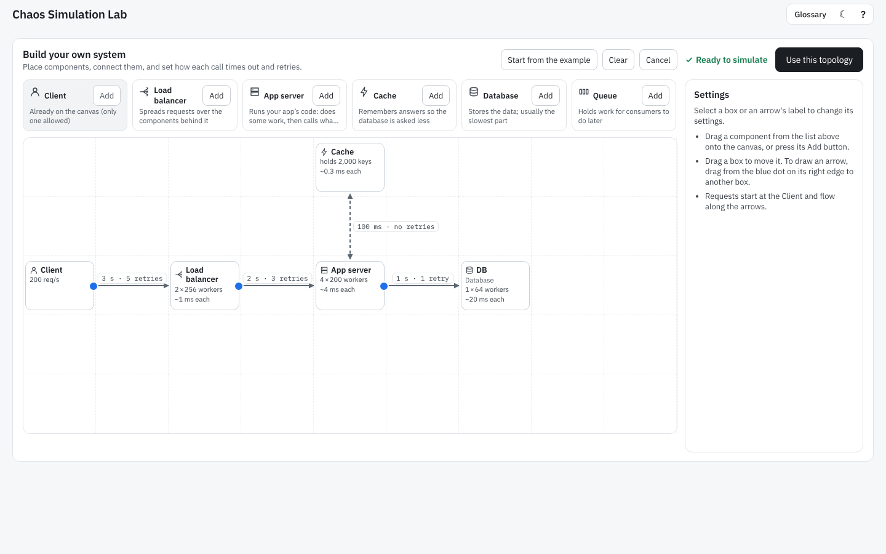
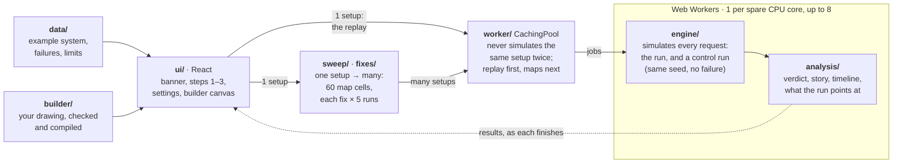

# Chaos Simulation Lab

**Try it:** https://ivory-tassel-sxy5.here.now/ (runs entirely in your browser, nothing to install)

Chaos Simulation Lab shows **how a short failure can take down an otherwise healthy system, and
keep it down**. You pick a failure (say, the database slows down for 5 seconds), watch a simulated system
of users, load balancer, app server, cache and database live through it, and see whether it
recovers. Then it answers the two questions that matter:

- **Where is the tipping point?** At what traffic, and for how long a failure, does the system stop
  recovering on its own?
- **Does a fix help?** Each candidate fix is re-run against the *same* traffic and the *same*
  failure, so you see what it really changes.



## What it demonstrates

The example on the opening page is a **retry storm**, a kind of *metastable failure*. The
database is slow for only 5 seconds, but every layer retries, and the retries alone keep it
overloaded long after the failure is over:



Nothing is scripted. The storm, the stuck state and the recovery (when a fix works) all come out
of a simulation of every single request.

## What to expect

| 1 · What happened | 2 · Where's the tipping point? | 3 · Does a fix help? |
|---|---|---|
| [](docs/images/step1-what-happened.png) | [](docs/images/step2-tipping-point.png) | [](docs/images/step3-does-a-fix-help.png) |
| A replay of one run: the diagram shows load, retries and errors moving through the system, and a short story explains each moment and the verdict (recovered, stuck, or too much traffic anyway). | The same failure re-run at 60 combinations of traffic and failure length. The map shows where the system tips from "recovers" to "stuck"; click any cell to replay it. | Fixes suggested by what the run showed (retry budgets, bounded queues, longer timeouts…), each tested on identical traffic, checked on 5 random runs and a longer failure, then ranked. Before and after maps show whether the tipping point moved. |

- **A one-minute guided demo** plays on your first visit (replay it with **?**). **Glossary**
  explains the jargon; **☾** switches to dark mode.
- **Change the failure** from the banner at the top: which part fails, how (slows down, goes down,
  loses one copy, a cache restarts empty), for how long, and the traffic. Every other setting
  (timeouts, retries, copies, cache size…) is in **Edit all settings**.
- **Build your own system** on a canvas: clients, load balancers, app servers, caches, databases and
  message queues, with branches. Problems in the drawing are listed in plain words before it runs.
- **Your work is kept in this browser** (localStorage). Nothing is sent anywhere.
- **Speed.** A replay is ready in about a second. A tipping-point map is 120 simulations, spread
  over your CPU cores; it fills in cell by cell and takes a few seconds on a typical laptop. Step 3
  tests about ten fixes and takes a little longer.
- **The numbers are illustrative.** The mechanisms are real and checked against queueing theory,
  but the system is a model: use it to build intuition, not to size production.
- **Limits.** Up to 5,000 requests a second and 3 million requests per run, at most 10 retries per
  call. Bigger runs are refused with a plain explanation.



## Architecture

A static site: there is no server. The page hands simulations to Web Workers, which run the
engine and analyse the result. Everything above the engine is plain data, so a new system or
failure needs no engine change.



Three ideas carry the design:

- **Every request is simulated.** Requests arrive whatever the system's state, as independent users
  do, and each one queues, waits for a worker and a CPU core, calls the next part, times out and
  retries. Retries, wasted work and an emptying cache emerge from that; none of it is a formula.
- **Identical randomness.** Every random value comes from a hash of (seed, request, attempt, part),
  never from a sequence. A fix therefore sees exactly the same traffic and service times as the run
  it is compared with.
- **"Recovered" means "back to how it behaves without the failure".** Each run is compared, second
  by second, with a control run (same seed, failure removed): the same requests succeed, latency and
  queues are back within the control's own range. No threshold is hand-tuned.

| Folder | What it holds |
|---|---|
| `src/engine` | Event queue, parts (copies, workers, cores, queues), calls (timeouts, retries, backoff), caches, message queues, failures |
| `src/analysis` | Recovery verdict against the control run, the story and timeline, the signals that pick fixes |
| `src/sweep` | Tipping-point maps and where each row tips |
| `src/fixes` | The fix catalogue (each fix is a setting change), how fixes are chosen, ranked and explained |
| `src/builder` | The drawing model, its checks and plain-language problems, compiling it to a topology |
| `src/data` | The example system, its failures, how titles and map axes follow from a failure, run-size limits |
| `src/worker` | Worker pool with priorities and cancellation, the result cache, job protocol |
| `src/ui` | React components, view models and styles |

## How we know it's right

About 1,200 tests run on every change, with a 90% coverage gate:

- **Queueing theory.** On long runs the engine matches analytic results (M/M/1, M/M/c, M/G/1, M/D/1,
  round-robin over several queues) within 3%, Little's law within 2%, and the cache's emergent hit
  rate matches the Che approximation within a point.
- **Invariants.** Requests are conserved at every part, worker and core limits are never exceeded,
  retries multiply exactly as configured, and runs are bit-for-bit repeatable.
- **Known failure patterns.** The retry storm gets stuck with retries and recovers without them,
  each extra retry lowers the tipping point, and a cache restart sends every lookup to the database.

**Modelled:** worker pools held while waiting on calls, CPU cores, per-copy queues, timeouts,
retries, backoff and jitter, retry budgets, work continuing on abandoned requests, cache-aside
caching (LRU, expiry, popular keys), message queues with consumers and dead-lettering, slow, dead
and partial failures.
**Not modelled:** network latency and loss, garbage-collection pauses, CPU contention, autoscaling,
health checks, users giving up or refreshing, database writes and replicas. Smaller
simplifications are marked `ASSUMPTION:` in the code.

## Running it locally

```bash
npm install
npm run dev        # http://localhost:5173
npm test           # all tests
npm run coverage   # tests with the coverage report
npm run bench      # engine throughput (events per second)
npm run deploy     # build and publish to here.now (needs HERENOW_API_KEY and HERENOW_SLUG)
```
